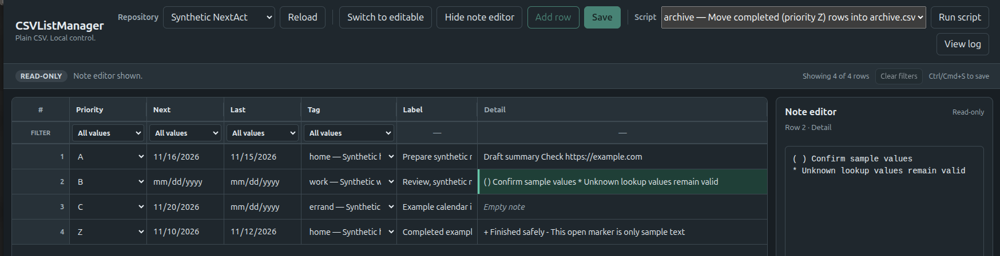

# CSVListManager

[](LICENSE)
[](README.md#requirements)
[](README.md#requirements)

CSVListManager is a configurable, local grid for editing plain RFC 4180 CSV data stores. The CSV remains the source of truth: there is no database, shadow index, cloud account, or runtime network dependency.



*The grid over the bundled synthetic example: typed columns, filter row, script menu, and the multi-line note editor.*

This repository contains a Python standard-library service and a dependency-free HTML/vanilla-JavaScript grid. Together they provide typed schemas, human-editable lookup files, safe explicit saves, repository preferences, stable view-only sorting, and an append-only CSV change log.

## Task Manager Use Case

CSVListManager was built as a simple CSV file editor for managing lists with a predefined structure. The primary use-case is to manage a task list with the following structure:
* Date columns for Next and Last (most recent) action on a task
* Priority as a lookup column on with predefined values: A, B, C for active tasks, L for backlog tasks, N for notes and Z for completed tasks.
* Tag lookup column with predefined tags for task subject matter
* Label as a single line descriptive text field
* Note as a multiline cell for task notes

Required features for the list manager use case include:
* CRUD functionality (Create, Read, Update, Delete) on tasks
* Archiving of completed items defined through an external python script called from within CSVListManager
* Filtering on column values (e.g. Priority = A and Next = today's date)
* Sorting on any column (note columns sort by presence/length only)
* Logging of changes

This task list implementation is a minimalist approach to task management. In particular, there's no nesting or linking tasks. Tasks can be grouped by label or tag as needed. The Priority value specifies what actions are in current focus, backlog or complete (similar to Kanban). Last and Next Action dates are drawn from the Getting-Things-Done (GTD) framework. The note field provides a place to store task history, requirements, plan, goal or any other relevant information. Sorting and filtering are sufficient tools to zoom-in on what needs to be worked on now or what is pending in the near future. This structure also serves as a simple calendar, with appointments treated as tasks.

Other use cases include any list management with a fixed data structure.

## Features

### Column types

CSVListManager is generic: the meaning of your data lives entirely in your schema, and every column is declared as one of five built-in types. Types drive how a column is displayed, edited, sorted, and filtered — they never police your data. Values already in the file that don't match a type are displayed as-is, never blocked or rewritten.

#### `text`

Single-line free text — the workhorse for names, titles, short values.

- Edited inline, directly in the grid cell.
- Sorts lexically, so alphabetical ordering is predictable.
- Best for: labels, titles, identifiers, any short one-liner.

#### `note`

Multi-line free text for content that doesn't fit a cell.

- Edited in an expanded pane rather than crammed into a row, with embedded newlines preserved byte-for-byte.
- Sorts by, at most, presence or length — content itself is never rearranged.
- Best for: descriptions, scratchpads, checklists, URLs, commands, anything long-form. What the content *means* is entirely your convention; the tool just preserves it exactly.

#### `date`

A calendar day in ISO format (`YYYY-MM-DD`), or empty.

- Edited with a date picker or typed directly; both produce the same unambiguous format.
- Sorts chronologically, so "what's coming up" is one click away.
- Can be filtered to an exact day (including a blank choice).
- Best for: deadlines, trigger dates, day-level timestamps.

#### `datetime`

A date and time (`YYYY-MM-DD HH:MM`), or empty.

- Like `date`, but down to the minute, with picker or keyboard entry and chronological sorting.
- Optionally carries managed behavior: an `on_create` column is stamped once when a row is created through the tool, and an `on_update` column is refreshed on every saved edit — giving you automatic audit columns with zero scripting. Without flags, it's a plain timestamp you manage yourself.
- Best for: created/updated tracking, minute-level scheduling.

#### `dropdown`

One value chosen from a list you define — either inline in the schema or from a separate lookup file you can edit by hand.

- Editing is a select control, so consistent categorical values are one click instead of free typing.
- Lookups can carry descriptions, so the meaning of each value is documented beside it.
- Tolerant by design: values present in the file but missing from the lookup still display as-is.
- Best for: statuses, categories, priorities, tags — anything where a controlled vocabulary keeps sorting and filtering meaningful.

#### What the type system buys you

- **Schema-driven, not code-driven.** Add, remove, or retype a column by editing the schema; the grid adapts with no tool changes.
- **The right editor for every cell.** Pickers for dates, selects for dropdowns, panes for notes, inline for text — no mode switching.
- **Meaningful sorting and filtering.** Dates sort by time, text by alphabet, dropdowns by list order; filters match exact values with blank included.
- **Your file stays honest.** Types are interpretive, not enforced: the CSV remains plain, portable, and exactly as you left it — in any editor, at all times.

### Data integrity first
- The CSV file is the source of truth — no database, shadow index, or cloud account
- Standards-compliant RFC 4180 parsing: quoted commas, quotes, empty fields, and embedded newlines all preserved
- Field-level saves that leave every untouched byte, quoting style, record order, and line ending exactly as it was
- Atomic temp-file-and-replace writes with automatic backup on failure
- Revision checks that refuse to silently overwrite edits made outside the app (HTTP 409, your work stays in the grid)

### Editing
- Inline editors matched to column type: native date/datetime pickers, dropdown selects, text inputs
- Multi-line note pane with full-cell editing that preserves each cell's original newline convention (LF or CRLF)
- Add rows (always appended at the bottom, never re-sorted into the file)
- Mark rows for deletion with undo; deletions apply only on explicit save
- Optional managed `on_create`/`on_update` datetime columns owned by the service
- Editable/read-only mode toggle per repository with a visible mode indicator
- Explicit Save button and Ctrl/Cmd+S, dirty-state indicator, and unsaved-changes warnings on reload, switch, and close

### Viewing and organization
- Sticky-header grid with stable ascending/descending sort — view-only, never reorders the file
- Exact-value filters on date and dropdown columns (including blank and unknown values), combinable with AND logic
- Live `Showing X of Y rows` count and one-click filter clearing
- Drag-to-resize columns (80–600 px) persisted per repository and column
- Show/hide note panel, persisted per repository
- Dark and light themes via system preference

### Automation and audit
- Configured external scripts (archive, cleanup, imports…) run from the browser with confirmation
- Scripts receive repository paths via environment variables; output and exit status are captured
- Failed scripts report visibly — never a false success — and the store is re-validated after every run
- Append-only CSV change log records every edit, addition, deletion, save, and script run
- Read-only in-app change-log viewer with human-readable formatting

### Architecture and deployment
- Python standard library only — zero runtime dependencies, nothing to build
- Dependency-free vanilla HTML/JS frontend — no npm, no frameworks
- Localhost-only HTTP service; no network access required at runtime
- Multiple named data repositories selectable from a dropdown, configured in one YAML file
- Schema-driven: columns, types, and lookups are configuration, not code — adapt it to any CSV without touching the source
- Runs anywhere Python 3.11+ runs; deploy to a headless box and reach it through an SSH tunnel

## Requirements

- Python 3.11 or later
- A modern browser
- No runtime packages outside the Python standard library
- Node.js 20 or later only for the optional JavaScript model tests

## Installation

CSVListManager runs directly from a source checkout: there is nothing to build and no packages to install.

```sh
git clone https://github.com/SKelliher/CSVListManager.git
cd CSVListManager
python3 -m csvlistmanager --config config.example.yaml --check  # validate the bundled example
python3 -m csvlistmanager --config config.example.yaml          # start the service
```

Open <http://127.0.0.1:8765> in a browser. Stop the service with Ctrl+C.

### Deploying on a fresh Linux host

1. Install Python 3.11+ and Git (for example `sudo apt install python3 git` on Debian/Ubuntu).
2. Clone the repository as above, or download and unpack the source ZIP from GitHub.
3. Copy `config.example.yaml` to `config.yaml` (ignored by Git) and edit it to point at your own data repositories; see [Configuration](#configuration).
4. Optionally verify the deployment: `python3 -m unittest discover -s tests`.
5. Optionally run the service in the background: `nohup python3 -m csvlistmanager --config config.yaml --port 8765 &`. The service binds to localhost only; to reach it from another machine use an SSH tunnel such as `ssh -L 8765:127.0.0.1:8765 user@host` and open <http://127.0.0.1:8765> locally.

## Run against the synthetic example

From a source checkout:

```sh
python3 -m csvlistmanager --config config.example.yaml --check
python3 -m csvlistmanager --config config.example.yaml
```

The service listens on `127.0.0.1:8765`. Open <http://127.0.0.1:8765> in a browser to use the grid. `--port 0` selects an available port. Non-loopback bind addresses are rejected.

The checked-in example can be edited through the API, so its files will become modified after saves. To keep the checkout pristine, copy `examples/nextact` and `config.example.yaml` to a local directory and adjust the paths in the copied configuration. The ignored `local/` directory is suitable for experiments.

## Browser editing

Click a non-note column heading to sort ascending, again for descending, and a third time to restore file order. Sorting changes only the view. Empty values sort last, and equal values retain their stable file order.

Text, date/datetime, and dropdown fields edit inline. Existing values that are invalid for a native date/datetime control fall back to a text input so they remain visible and unchanged. Unknown dropdown values are displayed as such. Managed datetime columns are visible but locked because the service owns their values.

Select any note cell to open the full note pane. **Hide note editor** collapses the panel without hiding note cells; reopening restores the selected note where possible. Panel visibility is persisted per repository. Note edits retain the cell's original newline convention, including CRLF embedded newlines. In read-only mode, notes remain selectable and readable while all editing and saving controls are disabled.

Drag a column's right border to resize it, or focus its resize separator and use the arrow keys. Widths from 80 to 600 pixels are persisted per repository and schema column name.

The second header row filters `date` and `dropdown` columns by one exact value. Choices include blank, lookup values, and unknown values actually present in the store. Multiple filters combine with AND logic and the active sort. The status bar shows `Showing X of Y rows` and provides **Clear filters**. Filters are session-only, are not written to preferences or CSV files, and remain active across saves/reloads in the same browser session. Editing and saving include dirty rows even when filters hide them.

**Add row** creates an in-memory row; **Save** or Ctrl/Cmd+S writes all pending changes explicitly. New rows always append at the bottom of the CSV regardless of view sorting or filtering. The per-row ✕ control marks an existing row for deletion (click again or ↩ to undo); deletions apply only on Save, never reorder the file, and are logged as `row_delete` entries with the removed values. Reload, repository switching, and browser closing protect unsaved changes with warnings. A revision conflict leaves edits in the grid and requires an explicit reload rather than silently overwriting external changes.

## Configuration

`config.example.yaml` demonstrates the application format:

```yaml
repository_root: .
preferences: local/preferences.json
repositories:
  sample:
    name: Synthetic NextAct
    directory: examples/nextact
    store: nextact.csv
    schema: schema.yaml
    log: changes.csv
    scripts:
      - name: archive
        command: [python3, archive.py]
        description: Move completed (priority Z) rows into archive.csv
```

The repository root is resolved relative to the configuration file. Store, schema, log, and lookup paths must remain inside their configured repository directory. All repositories, stores, schemas, and lookups are validated at startup; invalid user data is not modified.

### Multiple repositories

The `repositories` mapping holds any number of independent data repositories under one service. Each key is a repository id used in the API and the browser URL; each entry has a display `name` plus the paths of its own files:

```yaml
repositories:
  tasks:
    name: Tasks
    directory: data/tasks
    store: tasks.csv
    schema: tasks_schema.yaml
    log: tasks_changes.csv
  reading:
    name: Reading list
    directory: ~/Documents/reading
    store: books.csv
    schema: books_schema.yaml
    log: books_changes.csv
    scripts:
      - name: archive
        command: [python3, archive.py]
        description: Move finished books into the archive
```

Repositories are fully independent: each owns its directory, store, schema, lookups, change log, and scripts, so different repositories can carry entirely different columns and types. File paths may use `~` and are resolved against the repository root; every file must stay inside its own repository directory.

The browser offers all configured repositories in a dropdown and switches between them without restarting the service. The selected repository is persisted, and every view preference — edit/read-only mode, note-panel visibility, and per-column widths — is remembered per repository, so each list keeps its own layout.

Schemas declare an ordered `columns` list. Field types are `date`, `datetime`, `dropdown`, `text`, and `note`. Dropdowns use either inline values or a lookup CSV:

```yaml
columns:
  - name: Priority
    type: dropdown
    lookup:
      values: [A, B, C, Z]
  - name: Tag
    type: dropdown
    lookup:
      file: tags.csv
      column: tag
  - name: Created
    type: datetime
    on_create: true
  - name: Updated
    type: datetime
    on_update: true
```

Adding, removing, renaming, or reordering columns requires only schema and corresponding CSV header changes. Values outside a dropdown lookup are preserved and displayed; validation does not police existing data.

## Enhancements

Proposed features for future implementation:

- Multiple active filters with per-column removal — extend the current AND-combined filter row with individually dismissible filter chips.
- CSV import and export dialogs — bring rows in from, or push the store out to, other tools with column mapping.
- Saved filter presets — name and reuse common filter combinations (e.g. "priority A due today") per repository.
- Row duplication — clone an existing row into a new appended row for repetitive entries.
- Keyboard grid navigation — arrow-key cell movement and Enter-to-commit editing for keyboard-first workflows.

## Scripts

Scripts are configured external commands listed per repository. The service runs them from the repository directory, supplies `CSVLIST_REPOSITORY_DIR`, `CSVLIST_STORE`, and `CSVLIST_LOG` environment variables, captures output and exit status, appends a `script_run` entry to the change log, and reloads and re-validates the store afterward. A non-zero exit, a launch failure, a timeout, or a store that no longer loads is reported as a visible failure, never as success. Scripts own their domain logic and must perform their own atomic data transformations; see `examples/nextact/archive.py` for a working example. The browser **Run script** control asks for confirmation, is disabled while unsaved changes are pending, and reloads the grid after a successful run.

The dependency-free YAML reader supports indentation-based mappings/lists, plain and quoted scalars, and flow lists/mappings. It intentionally rejects unsupported features such as block scalars with a source line number rather than guessing.

## HTTP API

| Method | Endpoint | Purpose |
| --- | --- | --- |
| GET | `/api/health` | Service health |
| GET | `/api/repositories` | Repositories, selection, and modes |
| POST | `/api/repositories/select` | Persist the selected repository |
| GET | `/api/repository?repository=ID` | Load schema, lookups, rows, mode, view preferences, and revision |
| POST | `/api/preferences/mode` | Set `editable` or `read-only` mode |
| POST | `/api/preferences/view` | Set note visibility and per-column widths |
| POST | `/api/save` | Atomically apply changes, appended rows, and deletions |
| POST | `/api/scripts/run` | Run a configured script and re-validate the store |
| GET | `/api/log?repository=ID&limit=500` | Read the append-only change log |

A save supplies the loaded file revision, changed row indexes with only their changed values, and optional new rows and deleted row indexes:

```json
{
  "repository": "sample",
  "revision": "revision returned by GET /api/repository",
  "changes": [
    {"row": 0, "values": {"Next": "2027-01-15"}}
  ],
  "new_rows": [
    {"Priority": "B", "Label": "New synthetic item"}
  ],
  "deletions": [3]
}
```

A stale revision returns HTTP 409 without writing. A save in read-only mode returns HTTP 403. Sorting and filtering are view operations and are not part of save, so they cannot reorder the file or exclude hidden edits.

## Data safety and repository contents

Real data stores, personal configuration, credentials, preferences, and real change logs belong outside this source repository. `config.yaml`, `local/`, and `data/` are ignored. Only the invented records under `examples/` are committed.

Requirements and the implementation plan are in `docs/`.

## Tests

```sh
python3 -m unittest discover -s tests -v
node --test tests/js/*.test.mjs
```

Tests copy the dedicated synthetic fixture from `tests/fixtures/nextact` into temporary directories, so local edits to the runnable example do not affect test results. Python coverage includes byte-identical no-op round trips, exact field-level edits, embedded newlines, managed timestamps, appended rows, schema changes, read-only enforcement, external-edit conflicts, logging, view-preference validation/persistence, script success/failure/corruption handling, script-run log entries, static assets, and live localhost HTTP requests. JavaScript model tests cover stable sorting, exact and combined filters, blank/unknown filter values, file-order preservation, saving filtered-out edits, width limits, minimal save payloads, appended-row order, native editor fallback, note newline preservation, script result messages, and log entry formatting.

## License

MIT — see [`LICENSE`](LICENSE).
